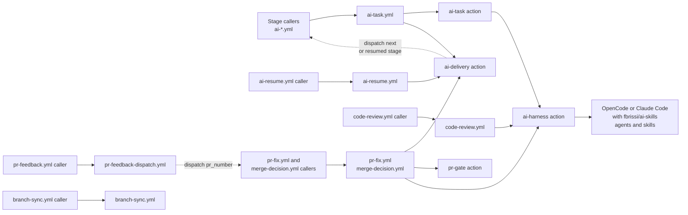
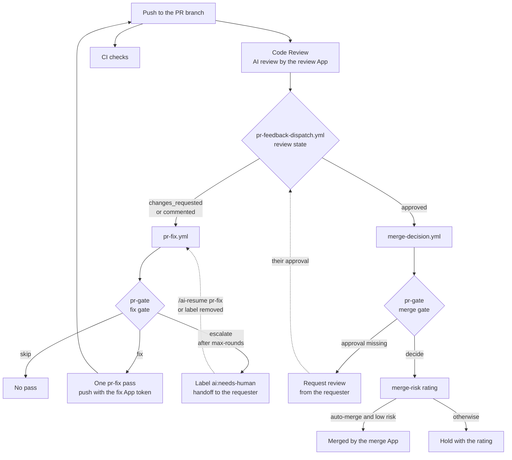
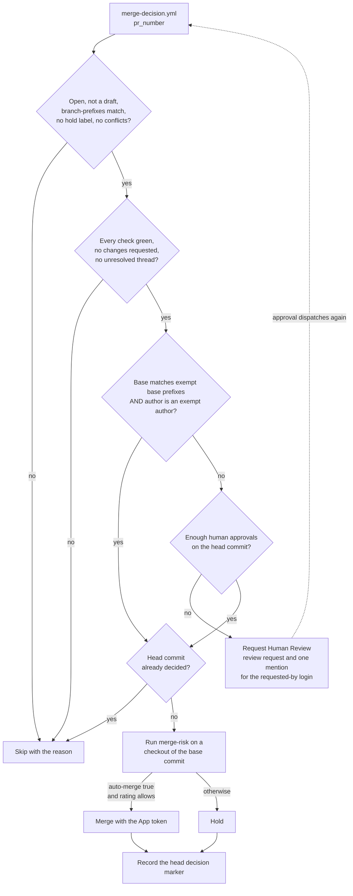
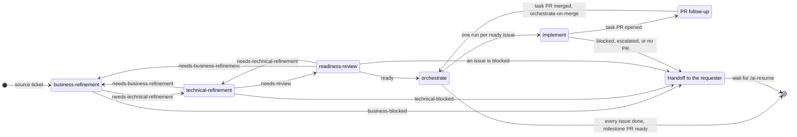
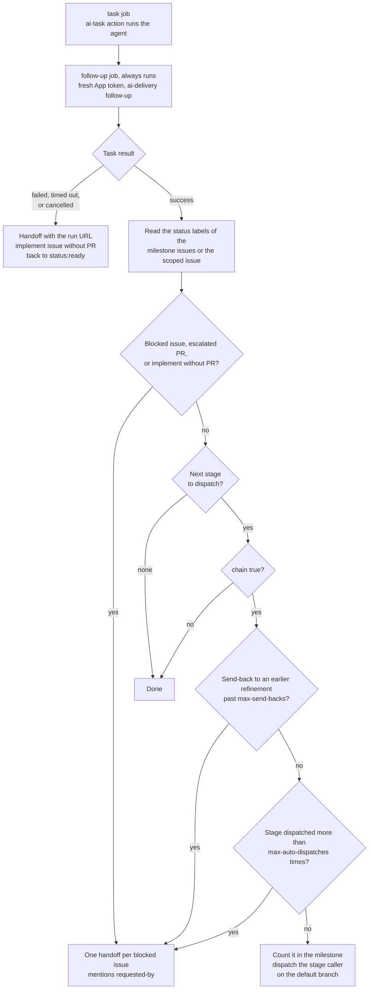
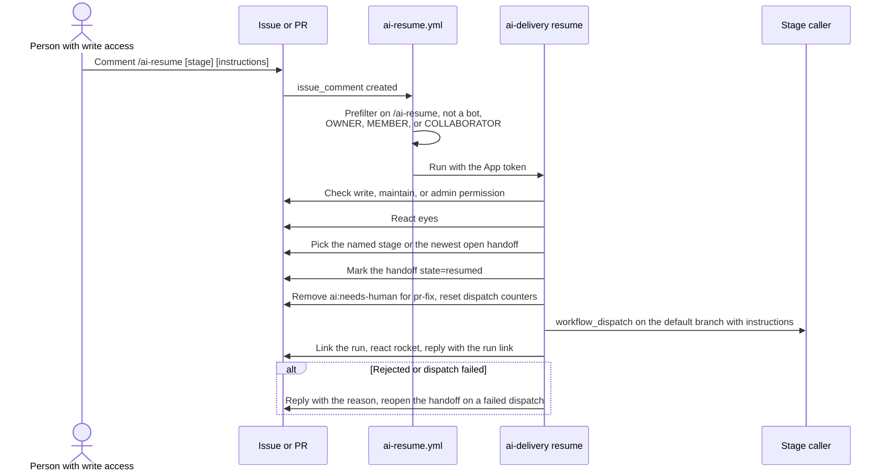
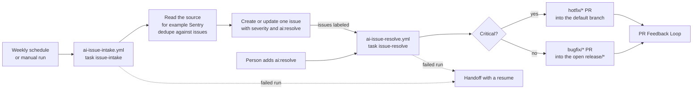
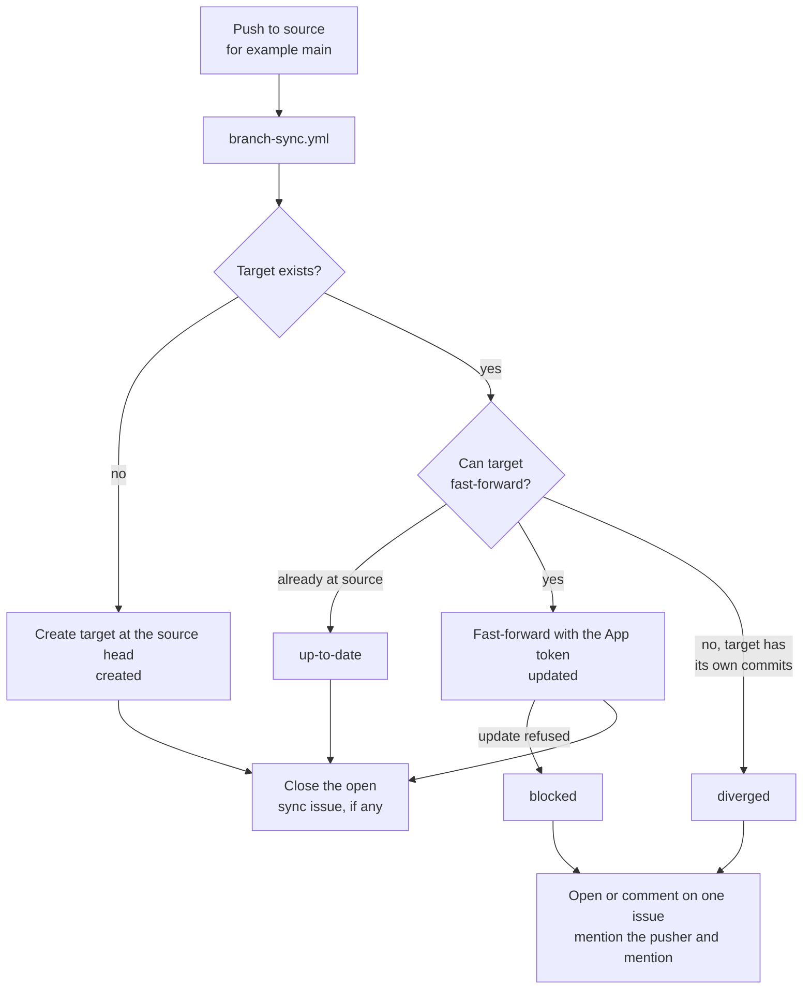

# github-actions

Reusable GitHub Actions workflows and composite actions for my personal projects: AI code review with a
switchable harness (OpenCode or Claude Code), changelog-driven releases, HCP Terraform helpers, and a Terraform
credential permission check.

Everything here is generic enough to be shared across repositories. Project-specific logic (build matrices,
deploys, credential rotation) stays in each project.

## Catalog

| Component | Type | Purpose |
|---|---|---|
| [`code-review.yml`](#code-review) | Reusable workflow | AI review of a pull request, reported as a `Code Review` check run. |
| [`pr-feedback-dispatch.yml`](#pr-feedback-dispatch) | Reusable workflow | Turns review and check events into fix and merge-decision dispatches on the default branch. |
| [`pr-fix.yml`](#pr-fix) | Reusable workflow | One AI pass that fixes review feedback and failing CI on an opted-in pull request. |
| [`merge-decision.yml`](#merge-decision) | Reusable workflow | Deterministic merge gates, then an AI risk rating that holds or (opt-in) merges. |
| [`ai-task.yml`](#ai-task) | Reusable workflow | Runs one AI task delivery task (refinement, readiness, orchestration, implementation) or issue task (intake, resolve) with its agent, then chains the next stage or hands off to a human. |
| [`ai-resume.yml`](#resume) | Reusable workflow | Resumes a stopped delivery stage when someone with write permission replies `/ai-resume [stage] [instructions]`. |
| [`branch-sync.yml`](#branch-sync) | Reusable workflow | Fast-forwards a branch (`develop`) to another (`main`) on every push; opens one issue when it cannot. |
| [`release-note.yml`](#release-note) | Reusable workflow | Requires each pull request to add one changelog release. |
| [`release.yml`](#release) | Reusable workflow | Tags and publishes the changelog release, then optionally deploys it. |
| [`terraform-permissions.yml`](#terraform-permissions) | Reusable workflow | Fails before merge when the Cloudflare Terraform token lacks a permission. |
| [`ai-harness`](actions/ai-harness/README.md) | Composite action | Installs OpenCode or Claude Code (pinned) and runs one prompt. |
| [`ai-task`](actions/ai-task/README.md) | Composite action | Validates an AI delivery task, installs its agents and skills, and runs it with `ai-harness`. |
| [`ai-delivery`](actions/ai-delivery/README.md) | Composite action | Deterministic delivery steps: chain or hand off after a stage, handoff comments, resume, review requests. |
| [`pr-gate`](actions/pr-gate/README.md) | Composite action | Deterministic PR follow-up gates and markers of `pr-fix.yml` and `merge-decision.yml`, for wrappers that load secrets at run time. |
| [`terraform-cloud-wait`](actions/terraform-cloud-wait/README.md) | Composite action | Waits for the HCP Terraform apply of a commit. |
| [`terraform-permissions`](actions/terraform-permissions/README.md) | Composite action | Checks a Cloudflare permission manifest and the real token. |

How the pieces fit: each caller in your repository calls one reusable workflow, which runs the composite actions. Dashed arrows are `workflow_dispatch` events that start the next run.



## Versioning

Releases follow [Semantic Versioning](https://semver.org/) and are cut from [CHANGELOG.md](CHANGELOG.md): every
pull request adds a `## vX.Y.Z` heading, and merging it creates the `vX.Y.Z` tag and GitHub release and moves the
major tag (`v1`) to it.

- `@v1` follows every compatible release. This is what the examples use.
- `@v1.2.3` or a full commit SHA freezes the version; Dependabot (`github-actions` ecosystem) can bump it.

Breaking input, secret, or behavior changes only ship in a new major version. The reusable workflows (which also
run `ai-delivery`), and the `ai-task` action (which runs `ai-harness`), call this repository's own actions at the same major tag (`@v1`): a
composite action cannot reference a sibling action by a relative path once it is called from a remote ref.

## Code Review

`.github/workflows/code-review.yml` reviews one pull request with an AI harness and publishes the review through a
GitHub App:

1. **Start Code Review** creates (or reuses) a check run on the PR head commit and marks it in progress. Draft and
   closed PRs fail here.
2. **Run Code Review** checks out the PR head with the base branch fetched, installs dependencies, installs the
   harness and the `review-changes` skill, runs the review, and verifies that the GitHub App published a review for
   the head commit (or that the harness skipped it on purpose, for example when there are no new findings).
3. **Finish Code Review** completes the check run with `success` or `failure`.

The review GitHub App needs repository permissions `Contents: Read and write`, `Pull requests: Read and write`, and
`Issues: Read`, and nothing else. `Contents: write` only makes its approval count toward required reviews: the token
handed to the harness is always scoped down to `contents: read`, `issues: read`, and `pull-requests: write`. Keep
other automation, such as Terraform, on a separate App so the review key never reaches secrets or variables.

### Caller

Dispatch the caller from the default branch so a pull request can never change its own reviewer, and so open pull
requests always run the current review setup without a rebase:

```yaml
# .github/workflows/code-review.yml
name: Code Review

on:
  workflow_dispatch:
    inputs:
      pr_number:
        description: Pull request number to review
        required: true
        type: string

permissions: {}

jobs:
  code-review:
    name: Code Review
    uses: fbrissi/github-actions/.github/workflows/code-review.yml@v1
    permissions:
      checks: write
      contents: read
      pull-requests: read
    with:
      pr-number: ${{ inputs.pr_number }}
      node-version: "24"
      install-command: yarn install --frozen-lockfile
      dependency-cache-path: node_modules
    secrets: inherit
```

Trigger it after the quality checks pass, on the default branch:

```yaml
      - name: Dispatch Code Review
        if: ${{ success() && github.event_name == 'pull_request' }}
        uses: actions/github-script@v9
        with:
          script: |
            await github.rest.actions.createWorkflowDispatch({
              owner: context.repo.owner,
              repo: context.repo.repo,
              workflow_id: 'code-review.yml',
              ref: context.payload.repository.default_branch,
              inputs: { pr_number: String(context.payload.pull_request.number) },
            });
```

Harness and model settings come from the [variables](#variables) of the calling repository (or of the review
`environment`) unless the matching input is set. The dispatching job needs `actions: write`. Do not add a `concurrency` group to the caller: the reusable workflow
already cancels an older review of the same pull request.

### Inputs

| Input | Default | Description |
|---|---|---|
| `pr-number` | – (required) | Pull request to review. |
| `agent-client-id` | `AGENT_APP_CLIENT_ID`, then `agent-app-id` | Client ID of the GitHub App that publishes the review. |
| `agent-app-id` | `AGENT_APP_ID` | Deprecated: App ID, used only when no client ID is set. |
| `harness` | `AI_HARNESS`, then `claude` | `opencode` or `claude`. |
| `opencode-command` | `pr/review` | OpenCode command that reviews the PR (Kompass). Empty uses the review-changes skill prompt. |
| `opencode-plugins` | `@kompassdev/opencode` | OpenCode plugins. Set `""` when `opencode-command` is empty. |
| `opencode-model` | `OPENCODE_MODEL` | Required by the `opencode` harness. |
| `opencode-variant` | `OPENCODE_VARIANT` | OpenCode model variant. |
| `claude-model` | `CLAUDE_MODEL` | Claude Code model. |
| `claude-effort` | `CLAUDE_EFFORT` | Claude Code effort level. |
| `prompt` | `""` | Overrides the generated prompt. |
| `instructions` | `""` | Per-run instructions appended to the prompt under `Additional instructions for this run:`; with `opencode-command` they are part of the command arguments. |
| `review-skill-source` | `ai-skills` | `ai-skills` (pinned `ai-skills-ref`), `base` (the PR base commit, for the skills repository itself), or `none`. |
| `ai-skills-ref` | `v0.2.0` | `fbrissi/ai-skills` tag or SHA used with `ai-skills`. |
| `base-skills-path` | `.rulesync/skills` | Skills directory read from the base commit with `base`. |
| `check-name` | `Code Review` | Check run name. |
| `environment` | `code-review` | Environment of the review job; its secrets are visible to the job. |
| `runs-on` | `CI_RUNNER`, then `ubuntu-latest` | Runner label of every job. |
| `timeout-minutes` | `25` | Harness run timeout. |
| `job-timeout-minutes` | `30` | Review job timeout. |
| `node-version` | `""` | Node.js version for actions/setup-node; empty skips it. |
| `node-cache` | `""` | `npm`, `yarn`, or `pnpm` cache for actions/setup-node. Only used with `save-dependency-cache`. |
| `install-command` | `""` | Dependency install command; empty skips it. |
| `dependency-cache-path` | `""` | Paths cached around `install-command` (for example `node_modules`). |
| `dependency-cache-prefix` | `code-review-deps-v1` | Cache key prefix; the key is `<prefix>-<os>-<arch>-<hash>`. A quality workflow can pre-warm the same key. |
| `dependency-cache-files` | `**/{package-lock.json,yarn.lock,pnpm-lock.yaml}` | Files hashed into the cache key. |
| `save-dependency-cache` | `false` | Save the cache after installing the PR's dependencies. Keep it off and warm the same key from the default branch. |

### Secrets

Pass them with `secrets: inherit` or explicitly under the same names. Secrets stored in the `environment` are also
available to the review job.

`secrets: inherit` only works when the caller belongs to the same owner as this repository (`fbrissi`). Callers in
another organization must pass each secret explicitly, or organization secrets arrive empty:

```yaml
    secrets:
      AGENT_APP_PRIVATE_KEY: ${{ secrets.AGENT_APP_PRIVATE_KEY }}
      OPEN_AI_TOKEN: ${{ secrets.OPEN_AI_TOKEN }}
      ANTHROPIC_API_KEY: ${{ secrets.ANTHROPIC_API_KEY }}
      CLAUDE_CODE_OAUTH_TOKEN: ${{ secrets.CLAUDE_CODE_OAUTH_TOKEN }}
```

| Secret | Required | Description |
|---|---|---|
| `AGENT_APP_PRIVATE_KEY` | yes | Private key of the review GitHub App. |
| `OPEN_AI_TOKEN` | `opencode` | OpenAI API key. |
| `ANTHROPIC_API_KEY` | `claude` (this or the next) | Anthropic API key. |
| `CLAUDE_CODE_OAUTH_TOKEN` | `claude` (this or the previous) | Claude Code OAuth token, used when `ANTHROPIC_API_KEY` is empty. |

### Outputs

| Output | Description |
|---|---|
| `check-run-id` | Check run that reports the review. |

## PR Feedback Loop

Three workflows follow a pull request up event by event instead of one agent that blocks on CI:

1. A review arrives. [`pr-feedback-dispatch.yml`](#pr-feedback-dispatch) dispatches the fix workflow for
   `changes_requested` (or `commented` with a body or inline comments) and the merge workflow for `approved`.
2. [`pr-fix.yml`](#pr-fix) runs one fix pass and pushes with a GitHub App token. Unlike `GITHUB_TOKEN` pushes, App
   pushes trigger CI, so the code review runs again and its review closes the loop.
3. [`merge-decision.yml`](#merge-decision) checks the merge gates without AI and, when they pass, rates the risk
   with the `merge-risk` skill. It holds by default and merges only with `auto-merge: true`.



Both targets are dispatched on the default branch, so a pull request can never change its own fixer or merger. Use
separate GitHub Apps (one `environment` each, with its own `AGENT_APP_CLIENT_ID` and `AGENT_APP_PRIVATE_KEY`) for
review, fix, and merge, so the fixer's replies are never mistaken for review feedback and the reviewer can never
merge.
When one App does both, set `ignore-reply-authors` to its bot instead of `ignore-authors`: its fix replies are
ignored and its new reviews still dispatch fixes.

The gates and markers of both workflows live in the [`pr-gate`](actions/pr-gate/README.md) action. Callers that load
the App key and AI keys at run time (for example from a cloud secret store), which a reusable workflow cannot receive
as `secrets`, can build their own wrapper from `pr-gate`, [`ai-harness`](actions/ai-harness/README.md), and
[`ai-delivery`](actions/ai-delivery/README.md) with the same behavior.

### PR Feedback Dispatch

`.github/workflows/pr-feedback-dispatch.yml` needs no secrets and never checks out code. It skips fork pull
requests, whose `GITHUB_TOKEN` is read-only.

```yaml
# .github/workflows/pr-feedback.yml
name: PR Feedback

on:
  pull_request_review:
    types: [submitted]
  check_run:
    types: [completed]

permissions: {}

jobs:
  dispatch:
    name: PR Feedback
    uses: fbrissi/github-actions/.github/workflows/pr-feedback-dispatch.yml@v1
    permissions:
      actions: write
      pull-requests: read
    with:
      ignore-authors: my-fixer-app[bot]
```

| Input | Default | Description |
|---|---|---|
| `fix-workflow` | `pr-fix.yml` | Dispatched with `pr_number` on a `changes_requested` review, or a `commented` one with a body or inline comments. Empty disables it. |
| `merge-workflow` | `merge-decision.yml` | Dispatched with `pr_number` on an `approved` review or a successful `merge-check-name` check run. Empty disables it. |
| `ignore-authors` | `""` | Logins whose reviews never dispatch a fix, for example the fixer App bot, whose thread replies also emit review events. |
| `ignore-reply-authors` | `""` | Logins whose reply-only reviews (no body, every inline comment a reply) never dispatch a fix. Use it instead of `ignore-authors` when one App both reviews and fixes, so its new reviews still dispatch fixes. |
| `merge-check-name` | `Code Review` | Successful check run that dispatches `merge-workflow` for each pull request in `check_run.pull_requests` (same repository only). Empty disables it. |
| `runs-on` | `CI_RUNNER`, then `ubuntu-latest` | Runner label. |

GitHub never starts `check_run` workflows for check runs whose suite was created by GitHub Actions, and events caused
by `GITHUB_TOKEN` never start workflows (except `workflow_dispatch` and `repository_dispatch`). The `Code Review`
check run of [`code-review.yml`](#code-review) is one of those, so `merge-check-name` only fires for check runs that
another GitHub App creates. To decide again after an approval that arrived before the review finished, dispatch the
merge workflow from the Code Review caller once the review succeeds:

```yaml
  merge-decision:
    name: Dispatch Merge Decision
    needs: code-review
    runs-on: ubuntu-latest
    permissions:
      actions: write
    steps:
      - uses: actions/github-script@v9
        env:
          PR_NUMBER: ${{ inputs.pr_number }}
        with:
          script: |
            await github.rest.actions.createWorkflowDispatch({
              owner: context.repo.owner,
              repo: context.repo.repo,
              workflow_id: 'merge-decision.yml',
              ref: context.payload.repository.default_branch,
              inputs: { pr_number: process.env.PR_NUMBER },
            });
```

### PR Fix

`.github/workflows/pr-fix.yml` runs one pass of the `pr-fix` skill in auto mode on one pull request:

1. **Check PR Fix Gates** skips (successfully, with `skipped: <reason>` in the step summary) unless the pull request
   is open, not a draft, from this repository, opted in (`opt-in-label` or a `branch-prefixes` match), and without
   `escalation-label`. Each pass leaves a `<!-- pr-fix round=N head=<sha> -->` comment; a pass is skipped when one
   exists for the current head and nobody but the fixer has commented or reviewed since. After `max-rounds` passes it
   adds `escalation-label` and posts one [handoff](#how-stages-chain) that mentions the person who started the flow
   (the `requested-by` marker of the PR's milestone, or of the issues it closes), explains the blocker, and offers a
   `pr-fix` resume; replying `/ai-resume` (with the [resume caller](#resume)) or removing the label allows
   `max-rounds` more. Otherwise it creates a `PR Fix` check run on the head commit.
2. **Run PR Fix** checks out the head branch with the App token, commits as the App bot, installs dependencies, and
   runs the harness. It never watches CI or waits for comments: the next review dispatches the next pass. It then
   records the round and fails if the branch was rewritten.
3. **Finish PR Fix** completes the check run.

```yaml
# .github/workflows/pr-fix.yml
name: PR Fix

on:
  workflow_dispatch:
    inputs:
      pr_number:
        description: Pull request number to fix
        required: true
        type: string
      instructions:
        description: Extra instructions for this run only
        required: false
        type: string

permissions: {}

jobs:
  pr-fix:
    name: PR Fix
    uses: fbrissi/github-actions/.github/workflows/pr-fix.yml@v1
    permissions:
      checks: write
      issues: read
      pull-requests: read
    with:
      pr-number: ${{ inputs.pr_number }}
      branch-prefixes: ai/
      instructions: ${{ inputs.instructions }}
      node-version: "24"
      install-command: npm ci
    secrets: inherit
```

The fixer GitHub App needs `Contents: Read and write`, `Pull requests: Read and write`, `Issues: Read`,
`Actions: Read`, and `Checks: Read`. When it is not the agent App, add its bot to `trusted-bots` of the
[resume caller](#resume) so its handoffs can be resumed. Do not grant it `Workflows`: GitHub then rejects any push that changes
`.github/workflows/**`.

| Input | Default | Description |
|---|---|---|
| `pr-number` | – (required) | Pull request to fix. |
| `opt-in-label` | `ai:auto-fix` | Label that opts a pull request in. |
| `branch-prefixes` | `""` | Head branch prefixes that also opt a pull request in (`startsWith`), for example `feature/ release/ hotfix/ bugfix/`. |
| `max-rounds` | `3` | Passes before escalation. |
| `escalation-label` | `ai:needs-human` | Added at `max-rounds`; blocks further passes while present. |
| `skills` | `pr-fix pr-checks` | Skills installed for the harness. |
| `agents` | `""` | Agents installed for the harness (Claude Code or OpenCode agents of the same name). |
| `prompt` | `""` | Overrides the generated prompt. |
| `instructions` | `""` | Per-run instructions appended to the prompt under `Additional instructions for this run:`. |
| `prompt-append` | `""` | Deprecated, use `instructions`. Appended to the prompt. |
| `skill-source` | `ai-skills` | `ai-skills` (pinned `ai-skills-ref`), `base` (the PR base commit), or `none`. |
| `ai-skills-ref` | `v0.4.0` | `fbrissi/ai-skills` tag or SHA used with `ai-skills`. |
| `base-skills-path` | `.rulesync/skills` | Skills directory read from the base commit with `base`. |
| `check-name` | `PR Fix` | Check run name. |
| `environment` | `pr-fix` | Environment of the fix job; its secrets are visible to the job. |
| `agent-client-id` | `AGENT_APP_CLIENT_ID` | Client ID of the fixer GitHub App. |

`harness`, `opencode-plugins` (default `""`), `opencode-model`, `opencode-variant`, `claude-model`, `claude-effort`,
`runs-on`, `timeout-minutes` (`25`), `job-timeout-minutes` (`30`), `node-version`, `node-cache`, `install-command`,
`dependency-cache-path`, `dependency-cache-prefix` (`pr-fix-deps-v1`), `dependency-cache-files`, and
`save-dependency-cache` work as in [Code Review](#inputs). Secrets are the same as [Code Review](#secrets). Output:
`result` (`fix`, `escalate`, or `skip`).

### Merge Decision

`.github/workflows/merge-decision.yml` decides on one pull request:

1. **Check Merge Gates** skips (successfully, with `skipped: <reason>`) unless the pull request is open, not a draft,
   on a head branch matching `branch-prefixes` (when set), without `hold-labels`, free of conflicts, with every check
   run and commit status on the head commit completed and
   successful (`neutral` and `skipped` count; runs started by review or check events, such as the dispatcher, are
   ignored), with no standing `CHANGES_REQUESTED`, at least `required-human-approvals` approvals on the head commit by
   users (not bots or Apps; none when the base branch matches `human-approval-exempt-base-prefixes` and the author
   matches `human-approval-exempt-authors`), no unresolved review threads, and no decision recorded for the head
   commit yet.
2. **Request Human Review** runs only when the approvals are missing (and `request-human-review` is on): it requests
   a review from the person who started the flow (the `requested-by` marker of the PR's milestone, or of the issues
   it closes) and mentions them once per pull request (`<!-- merge-decision review-requested=<login> -->`). Their
   approval dispatches the decision again through [PR Feedback Dispatch](#pr-feedback-dispatch).
3. **Run Merge Decision** checks out the base commit (never the pull request) so the `merge-risk` profile cannot be
   changed by the change it rates, runs the skill in decide mode with the base branch, the required approvals, and
   the approval rule (with 0 required approvals an empty `reviewDecision` passes and only `CHANGES_REQUESTED`, or
   `REVIEW_REQUIRED` from branch protection, fails; otherwise it counts human approvals on the head commit from the
   reviews, never `reviewDecision` alone), and records a
   `<!-- merge-decision head=<sha> -->` comment, so each head commit is decided once. Push a commit (or delete that
   comment) to decide again.



The App token only gets `contents: write` with `auto-merge: true`, so with the default the harness cannot merge. A
merge made with the App token, unlike one made with `GITHUB_TOKEN`, triggers the release workflows of the merged
commit.

```yaml
# .github/workflows/merge-decision.yml
name: Merge Decision

on:
  workflow_dispatch:
    inputs:
      pr_number:
        description: Pull request number to decide on
        required: true
        type: string

permissions: {}

jobs:
  merge-decision:
    name: Merge Decision
    uses: fbrissi/github-actions/.github/workflows/merge-decision.yml@v1
    permissions:
      actions: read
      checks: read
      contents: read
      issues: read
      pull-requests: read
      statuses: read
    with:
      pr-number: ${{ inputs.pr_number }}
      auto-merge: false
    secrets: inherit
```

The merge GitHub App needs `Contents: Read and write` (`Read` is enough while `auto-merge` is off),
`Pull requests: Read and write`, `Issues: Read`, `Checks: Read`, and `Commit statuses: Read`, and must be allowed to
merge by the branch rules. Without `Workflows`, it cannot merge a pull request that changes `.github/workflows/**`.
The review request uses the same App with `pull-requests: write`.

| Input | Default | Description |
|---|---|---|
| `pr-number` | – (required) | Pull request to decide on. |
| `auto-merge` | `false` | Let the AI merge; when false it only rates the risk and holds. |
| `required-human-approvals` | `1` | Human approvals required on the head commit. |
| `human-approval-exempt-base-prefixes` | `""` | Base branch prefixes whose pull requests need no human approval when the author is exempt too, for example `release/` for task PRs into release branches. |
| `human-approval-exempt-authors` | `""` (any GitHub App bot) | Authors that may skip human approval into an exempt base, for example the agent App bot `my-agent[bot]`. Pull requests by people always need `required-human-approvals`. |
| `request-human-review` | `true` | Request a review from the flow's requester and mention them once while approvals are missing. |
| `hold-labels` | `do-not-merge hold` | Labels that block a decision. |
| `branch-prefixes` | `""` | Head branch prefixes a pull request must match (`startsWith`), for example `feature/ release/ hotfix/ bugfix/`; empty decides on every pull request. |
| `skills` | `merge-risk` | Skills installed for the harness. |
| `agents` | `""` | Agents installed for the harness (Claude Code or OpenCode agents of the same name). |
| `prompt` | `""` | Overrides the generated prompt. |
| `instructions` | `""` | Per-run instructions appended to the prompt under `Additional instructions for this run:`. |
| `prompt-append` | `""` | Deprecated, use `instructions`. Appended to the prompt. |
| `skill-source` | `ai-skills` | `ai-skills` (pinned `ai-skills-ref`), `base` (the base commit), or `none`. |
| `ai-skills-ref` | `v0.4.0` | `fbrissi/ai-skills` tag or SHA used with `ai-skills`. |
| `base-skills-path` | `.rulesync/skills` | Skills directory read from the base commit with `base`. |
| `environment` | `merge-decision` | Environment of the decision job; its secrets are visible to the job. |
| `agent-client-id` | `AGENT_APP_CLIENT_ID` | Client ID of the merge GitHub App. |
| `timeout-minutes` | `15` | Harness run timeout. |
| `job-timeout-minutes` | `20` | Decision job timeout. |

`harness`, `opencode-plugins` (default `""`), `opencode-model`, `opencode-variant`, `claude-model`, `claude-effort`,
and `runs-on` work as in [Code Review](#inputs). Secrets are the same as [Code Review](#secrets). Output: `result`
(`decide` or `skip`).

## AI Task

`.github/workflows/ai-task.yml` runs one task of the AI task delivery flow with the
[`ai-task`](actions/ai-task/README.md) action: it creates a GitHub App token scoped to the task, checks out the
calling ref with full history and the token as push credentials, sets the git identity to the App bot, installs
dependencies, runs the optional `setup-command`, and runs the task's
[fbrissi/ai-skills](https://github.com/fbrissi/ai-skills) agent with OpenCode or Claude Code (`AI_HARNESS`). A follow-up job then chains the
next stage or hands off to a human (see [How stages chain](#how-stages-chain)).

| Task | Agent | Input | What it does |
|---|---|---|---|
| `business-refinement` | `business-analyst` | `source` | Turns a source ticket (Jira, GitHub issue, or milestone) into a GitHub milestone and business-level issues, or asks the source what is unclear. |
| `technical-refinement` | `tech-lead` | `milestone` or `issue` | Writes the technical plan of each issue so the milestone's issues can be built in parallel. |
| `readiness-review` | `readiness-reviewer` | `milestone` or `issue` | Marks each issue ready or sends it back to refinement. |
| `orchestrate` | `delivery-orchestrator` | `milestone` | Creates the milestone and task branches and dispatches `implement` for each ready issue whose dependencies are done; opens the milestone PR when every issue is done. Never codes. |
| `implement` | `task-implementer` | `issue`, `branch`, `base-branch` | Implements the issue, runs the review and QA cycle, and opens a PR into the milestone (release) branch. |
| `issue-intake`, `issue-resolve` | `issue-resolver` | –, `issue` | See [Issue intake and resolve](#issue-intake-and-resolve). |

Runs never wait for input: blocked tasks leave their questions on the ticket or issue and stop. Inputs left empty
are not sent, so the repository profile (`docs/ai/delivery.md`) and then the skill defaults apply.

Runs are serialized per repository, task, and issue (or milestone, or source) without cancelling: a new run waits
for the current one, and only the newest waiting run is kept.

### Setup from zero

Do these once per repository, in this order:

1. **Releases.** Tag `fbrissi/ai-skills` first (the agents and skills, pinned by `ai-skills-ref`, default
   `v0.6.0`), then release this repository: the reusable workflows call `actions/ai-task@v1` and
   `actions/ai-delivery@v1`, so a workflow only works once a `v1` release contains those actions. Callers then use
   `@v1` (or a pinned `@v1.8.0`).
2. **GitHub App** for the agent, installed on the repository, with these repository permissions:
   `Contents`, `Issues`, `Pull requests`, and `Actions` (read and write; `Actions: write` dispatches the next stage,
   the implement runs, and resumes), `Metadata` (read), plus `Organization projects` (read and write) on an
   organization installation when `project` is used. Without `Workflows`, it can never push
   `.github/workflows/**`. Use separate Apps for [PR Fix](#pr-fix) and [Merge Decision](#merge-decision) if you
   want their permissions apart (see [PR Feedback Loop](#pr-feedback-loop)).
3. **Secrets** (repository, organization, or the `environment`): `AGENT_APP_PRIVATE_KEY`, the harness credential
   (`OPEN_AI_TOKEN` for OpenCode with an `openai/` model; `ANTHROPIC_API_KEY` or `CLAUDE_CODE_OAUTH_TOKEN` for Claude
   Code), and `JIRA_EMAIL` plus `JIRA_API_TOKEN` for Jira sources.
4. **Variables:** `AGENT_APP_CLIENT_ID`, the harness (`AI_HARNESS`: `claude` by default, with optional `CLAUDE_MODEL` and `CLAUDE_EFFORT`, or `opencode` with `OPENCODE_MODEL` and
   optional `OPENCODE_VARIANT`), and optional
   `CI_RUNNER` and `JIRA_BASE_URL`. Every AI workflow reads the same ones; see [Variables](#variables).
5. **Labels** the flow sets but never creates:

   ```bash
   for state in needs-business-refinement business-blocked needs-technical-refinement technical-blocked \
     needs-review ready in-progress in-review done; do
     gh label create "status:${state}" --force
   done
   gh label create ai:auto-fix --force      # opts a pull request into PR Fix
   gh label create ai:needs-human --force   # set by PR Fix when it escalates
   gh label create do-not-merge --force     # hold labels of Merge Decision
   gh label create hold --force
   ```

   Rename them with `status-labels` (`state=label` lines) if the repository already uses other names.
6. **Project** (optional): a single-select `Status` field (or `project-status-field`) with one option per state,
   by default the Title Case of the state: `Needs Business Refinement`, `Business Blocked`,
   `Needs Technical Refinement`, `Technical Blocked`, `Needs Review`, `Ready`, `In Progress`, `In Review`, `Done`.
   Map several states to one option with `project-status-options`, for example `business-blocked=Blocked`.
7. **Profile:** commit `docs/ai/delivery.md` (template: `references/delivery-profile.md` of the
   `delivery-orchestration` skill in fbrissi/ai-skills) with the milestone template, branch names, test commands,
   and the test environment.
8. **Callers** on the default branch (dispatch only finds workflows there): the five [stage callers](#callers),
   the [resume caller](#resume), the [orchestrate-on-merge caller](#callers), and the
   [PR follow-up callers](#pr-follow-up-for-task-branches).
9. **Branch rules:** let the merge App merge into release branches (`release/**`), and keep one human approval on
   the default branch (`main`). See [Branch model](#branch-model).

Start a delivery with **Actions > AI Business Refinement > Run workflow** and the Jira key (or
`gh workflow run ai-business-refinement.yml -f source=DEV-1`). Everything after that runs on its own until a stage
needs a person.

### How stages chain

After every run, the `follow-up` job takes a fresh App token (the task's token may have expired) and reads the
`status:*` labels of the milestone's open issues (or of `issue` when the run was scoped to one):

| Finished stage | Hands off when | Otherwise dispatches |
|---|---|---|
| `business-refinement` | an issue is `business-blocked` | `technical-refinement` when an issue `needs-technical-refinement` |
| `technical-refinement` | an issue is `technical-blocked` | `business-refinement` when an issue `needs-business-refinement`, else `readiness-review` when one `needs-review` |
| `readiness-review` | an issue is `business-blocked` or `technical-blocked` | `business-refinement`, else `technical-refinement`, else `orchestrate` when an issue is `ready` |
| `orchestrate` | – | nothing: it dispatches `implement` itself, and the orchestrate-on-merge caller re-runs it |
| `implement` | the issue is blocked, its PR or issue has `ai:needs-human`, or the run ended without a PR | nothing: the [PR follow-up](#pr-follow-up-for-task-branches) takes the PR from here |

The stages and the labels that move a milestone between them:



- **Failed, timed-out, or cancelled runs** hand off with `run failed: <run URL>` and resume the same stage
  (`pr-fix` when the implement PR already exists). An `implement` issue left in `status:in-progress` without a PR
  moves back to `status:ready`, so it does not hold an orchestration slot.
- **Dispatches** go to the default branch with the stage caller's `workflow_dispatch` inputs: `milestone`,
  `issue` (technical refinement and readiness review, when the run was scoped to one issue), `jira_key` (business
  refinement), `branch` and `base_branch` (implement), and `requested_by`. File names come from `stage-workflows`.
  An input a caller does not declare is dropped with a warning, so older callers keep working.
- **Loop guard.** Each automatic dispatch of a stage increments a counter in the milestone description
  (`<!-- ai-delivery-dispatches stage=N -->`). Past `max-auto-dispatches` (default `3`) the follow-up hands off
  instead; a resume resets the counters.
- **Send-back limit.** A dispatch to an earlier refinement stage (readiness review back to business or technical
  refinement, or technical refinement back to business refinement) is a send-back, counted as `send-backs=N` in the
  same marker. Past `max-send-backs` (default `1`) the follow-up hands off to the requester to investigate why the
  refinement did not fix it; a resume resets the counter.
- **Requester.** `requested-by` (default `github.triggering_actor`) is stored in the milestone description as
  `<!-- ai-delivery requested-by=<login> -->` and passed on as `requested_by` to every dispatch. Runs started by the
  App (whose triggering actor is the bot) use the marker instead, and bots are never mentioned. PR Fix and Merge
  Decision read the same marker from the PR's milestone, or the milestone of the issues it closes.
- `chain: false` keeps the handoffs and only stops the dispatches.

What the `follow-up` job decides after each run:



Each handoff is one comment per blocked issue (or a tracking issue `<milestone or source> - <stage>` when there is
none). It mentions the requester, gives the blocker in up to three lines, links the questions (the last comment on
the issue, and the Jira ticket for business refinement), and ends with:

```markdown
Answer where the questions are, then resume.
Reply `/ai-resume` (optionally with instructions on the next lines) to continue: technical-refinement -> readiness-review.
<!-- ai-resume stage=technical-refinement milestone=JIRA:DEV-1 issue=12 pr= requested-by=alice ... workflow=ai-technical-refinement.yml state=open -->
```

plus a collapsed `gh workflow run ...` fallback. An open handoff (`state=open`) for the same stage is never posted
twice.

### Resume

Answer the questions where they were asked, then reply on the issue or pull request with a new comment whose first
line starts with `/ai-resume`:

```text
/ai-resume [stage] [instructions]
more instructions on the next lines
```

The stage is optional. It is a stage name (`business-refinement`, `technical-refinement`, `readiness-review`,
`orchestrate`, `implement`, `pr-fix`, `issue-intake`, `issue-resolve`) or a skill or agent name a blocker comment
used as its stage (`delivery-orchestration` -> `orchestrate`; `dev`, `quality-cycle`, `task-implementer` ->
`implement`; `issue-resolver` -> `issue-resolve`; and the other task agents); an unknown stage-like word gets a reply
with the valid stages. Anything after it on the first line, plus the following lines, becomes the `instructions` of
the resumed run (appended to its prompt for that run only). `.github/workflows/ai-resume.yml` runs on the
`issue_comment` `created` event. Its job only starts for comments that begin with `/ai-resume`, are not written by
a bot, and come from an `OWNER`, `MEMBER`, or `COLLABORATOR`; the script then checks that the author has write,
maintain, or admin permission. It then:

1. reacts with `eyes` on the command,
2. picks the target: the named stage (its newest handoff here, or the issue or pull request itself when there is
   none), else the newest open handoff posted by the agent App bot (or one of `trusted-bots`). With neither, it
   replies with the list of stages and dispatches nothing,
3. marks the handoff `state=resumed` (`Resumed by @<login>`) before dispatching, so a second command finds nothing
   open; runs are serialized per issue or pull request,
4. removes the escalation label (`ai:needs-human`) of the pull request when the stage is `pr-fix`, and resets the
   milestone's automatic dispatch counters,
5. dispatches the stage caller (the workflow named in the marker, else `stage-workflows`) on the default branch with
   `milestone`, `issue`, `jira_key`, `branch`, `base_branch`, or `pr_number`, `requested_by`, and `instructions`,
6. links the run in the handoff (`Resumed by @<login> -> <run link>`), reacts with `rocket`, and replies with the
   run link.



A rejection (no permission, no open handoff, invalid values) is a reply with the reason. If the dispatch fails, the
handoff is reopened, the reply says so, and the job fails. Handoffs posted with the earlier checkbox resume the same
way. The resumed stage reads the human's answer and the chain continues on its own.

```yaml
# .github/workflows/ai-resume.yml
name: AI Resume

on:
  issue_comment:
    types: [created]

permissions: {}

jobs:
  resume:
    if: ${{ startsWith(github.event.comment.body, '/ai-resume') }}
    uses: fbrissi/github-actions/.github/workflows/ai-resume.yml@v1
    with:
      trusted-bots: my-fixer-app[bot] # the PR Fix App, when it is not the agent App
    secrets:
      AGENT_APP_PRIVATE_KEY: ${{ secrets.AGENT_APP_PRIVATE_KEY }}
```

| Input | Default | Description |
|---|---|---|
| `stage-workflows` | `""` | `stage=file` overrides used when a handoff does not name its workflow (defaults below). |
| `trusted-bots` | `""` | Other bot logins whose handoffs may be resumed, for example the PR Fix App. The agent App's own bot is always trusted. |
| `agent-client-id` | `AGENT_APP_CLIENT_ID` | Client ID of the agent App. |
| `environment` | `""` | Environment of the job. |
| `runs-on` | `CI_RUNNER`, then `ubuntu-latest` | Runner label. |

Secret: `AGENT_APP_PRIVATE_KEY`. The caller needs no `GITHUB_TOKEN` permissions: the App token (`actions`,
`issues`, and `pull-requests` write) dispatches the stage, edits the handoff, and posts the reactions and replies, so
the App needs `Actions`, `Issues`, and `Pull requests` read and write.

### QA in CI

The implement agent runs browser QA (Playwright, or Selenium if the project uses it) when the profile's test
environment is reachable. Install the browsers and start the environment with `setup-command`, which runs after
`install-command` and before the agent; background processes and `docker compose up -d` services stay up for the
agent:

```yaml
      setup-command: |
        npx playwright install --with-deps chromium
        docker compose up -d --wait
```

Without a reachable environment, QA runs in tests-only mode: it relies on the automated tests that already run as PR
checks, reports `browser QA skipped: no CI environment`, and never escalates for that reason.

### GitHub App

The App the agent acts as needs the permissions in [Setup from zero](#setup-from-zero). The token handed to the
agent is scoped per task:

| Task | Token permissions |
|---|---|
| `business-refinement`, `technical-refinement`, `readiness-review` | `contents: read`, `issues: write`, `pull-requests: read` |
| `orchestrate` | `contents: write`, `issues: write`, `pull-requests: write`, `actions: write` |
| `implement`, `issue-resolve` | `contents: write`, `issues: write`, `pull-requests: write` |
| `issue-intake` | `contents: read`, `issues: write`, `pull-requests: read` |
| any, with `project` | adds `organization-projects: write` |
| any, with `app-token-permission-issue-fields: write` | adds `issue-fields: write` |
| follow-up job | `actions: write`, `issues: write`, `pull-requests: read` |

Organization issue field values (for example Priority, Effort, Start date, Target date) need the `issue-fields:
write` token permission. Set `app-token-permission-issue-fields: write` when the profile uses issue fields and the
agent App has the Issue fields permission; without it the agent cannot set them and readiness review sends the
issues back.

Set `project` as a workflow input, not only in the profile, so the token gets the projects permission. Projects
must belong to the organization that owns the repository: App installation tokens cannot reach projects of
a user account or of another organization. The token expires after one hour, so keep `timeout-minutes` under it. It
has no `workflows` permission, so the agent cannot push changes to `.github/workflows/`.

### Callers

Each task gets its own `workflow_dispatch` caller on the default branch, named as in `stage-workflows` (defaults
below). Declare the inputs the follow-up and the resume send, all optional, and pass `requested_by` on. The caller
job only needs `contents: read`; everything the agent does goes through the App token.

| Stage | Default caller | Dispatch inputs |
|---|---|---|
| `business-refinement` | `ai-business-refinement.yml` | `milestone`, `jira_key`, `requested_by` (plus your own `source`) |
| `technical-refinement` | `ai-technical-refinement.yml` | `milestone`, `issue`, `requested_by` |
| `readiness-review` | `ai-readiness-review.yml` | `milestone`, `issue`, `requested_by` |
| `orchestrate` | `ai-orchestrate.yml` | `milestone`, `requested_by` |
| `implement` | `ai-implement.yml` | `issue`, `branch`, `base_branch`, `requested_by` |
| `pr-fix` | `pr-fix.yml` | `pr_number` |
| `issue-intake` | `ai-issue-intake.yml` | `requested_by` |
| `issue-resolve` | `ai-issue-resolve.yml` | `issue`, `requested_by` |

Declare an optional `instructions` input too and pass it to the reusable workflow (`instructions:
${{ inputs.instructions }}`): an `/ai-resume` command sends it, and a person can set it when running the caller by
hand. Chained dispatches never send it.

```yaml
# .github/workflows/ai-business-refinement.yml
name: AI Business Refinement

on:
  workflow_dispatch:
    inputs:
      source:
        description: Source ticket (Jira key or URL, GitHub issue, or milestone)
        required: false
        type: string
      jira_key:
        description: Jira key (set by the flow)
        required: false
        type: string
      milestone:
        description: GitHub milestone (set by the flow)
        required: false
        type: string
      requested_by:
        description: Person to mention when the flow needs a human
        required: false
        type: string
      instructions:
        description: Extra instructions for this run only
        required: false
        type: string

permissions: {}

jobs:
  refine:
    uses: fbrissi/github-actions/.github/workflows/ai-task.yml@v1
    permissions:
      contents: read
    with:
      task: business-refinement
      source: ${{ inputs.source || inputs.jira_key || inputs.milestone }}
      source-tracker: jira
      milestone-template: JIRA:{key}
      requested-by: ${{ inputs.requested_by }}
      instructions: ${{ inputs.instructions }}
    secrets:
      AGENT_APP_PRIVATE_KEY: ${{ secrets.AGENT_APP_PRIVATE_KEY }}
      ANTHROPIC_API_KEY: ${{ secrets.ANTHROPIC_API_KEY }}
      CLAUDE_CODE_OAUTH_TOKEN: ${{ secrets.CLAUDE_CODE_OAUTH_TOKEN }}
      JIRA_EMAIL: ${{ secrets.JIRA_EMAIL }}
      JIRA_API_TOKEN: ${{ secrets.JIRA_API_TOKEN }}
```

Set `milestone-template` in every caller (or in the profile) when milestones are named after Jira keys, so the
follow-up can find the milestone a business refinement created and send `jira_key` back to it.

Technical refinement, readiness review, and orchestration take a milestone (refinement and readiness also an
issue); only the `task` differs, and orchestration declares no `issue`:

```yaml
# .github/workflows/ai-technical-refinement.yml (and ai-readiness-review.yml, ai-orchestrate.yml)
name: AI Technical Refinement

on:
  workflow_dispatch:
    inputs:
      milestone:
        description: GitHub milestone
        required: false
        type: string
      issue:
        description: Issue number (only this issue)
        required: false
        type: string
      requested_by:
        description: Person to mention when the flow needs a human
        required: false
        type: string
      instructions:
        description: Extra instructions for this run only
        required: false
        type: string

permissions: {}

jobs:
  task:
    uses: fbrissi/github-actions/.github/workflows/ai-task.yml@v1
    permissions:
      contents: read
    with:
      task: technical-refinement # readiness-review, orchestrate
      milestone: ${{ inputs.milestone }}
      issue: ${{ inputs.issue }}
      milestone-template: JIRA:{key}
      requested-by: ${{ inputs.requested_by }}
      instructions: ${{ inputs.instructions }}
      node-version: "24"
      install-command: npm ci
    secrets:
      AGENT_APP_PRIVATE_KEY: ${{ secrets.AGENT_APP_PRIVATE_KEY }}
      ANTHROPIC_API_KEY: ${{ secrets.ANTHROPIC_API_KEY }}
      CLAUDE_CODE_OAUTH_TOKEN: ${{ secrets.CLAUDE_CODE_OAUTH_TOKEN }}
```

The orchestrator dispatches the implement caller (`implement-workflow`, default `ai-implement.yml`) with the inputs
`issue`, `branch`, and `base_branch`:

```yaml
# .github/workflows/ai-implement.yml
name: AI Implement

on:
  workflow_dispatch:
    inputs:
      issue:
        description: Issue number
        required: true
        type: string
      branch:
        description: Task branch
        required: true
        type: string
      base_branch:
        description: Milestone branch the PR targets
        required: true
        type: string
      requested_by:
        description: Person to mention when the flow needs a human
        required: false
        type: string
      instructions:
        description: Extra instructions for this run only
        required: false
        type: string

permissions: {}

jobs:
  implement:
    uses: fbrissi/github-actions/.github/workflows/ai-task.yml@v1
    permissions:
      contents: read
    with:
      task: implement
      issue: ${{ inputs.issue }}
      branch: ${{ inputs.branch }}
      base-branch: ${{ inputs.base_branch }}
      requested-by: ${{ inputs.requested_by }}
      instructions: ${{ inputs.instructions }}
      node-version: "24"
      install-command: npm ci
      dependency-cache-path: node_modules
      setup-command: npx playwright install --with-deps chromium
    secrets:
      AGENT_APP_PRIVATE_KEY: ${{ secrets.AGENT_APP_PRIVATE_KEY }}
      ANTHROPIC_API_KEY: ${{ secrets.ANTHROPIC_API_KEY }}
      CLAUDE_CODE_OAUTH_TOKEN: ${{ secrets.CLAUDE_CODE_OAUTH_TOKEN }}
```

Re-run the orchestrator each time a task PR (`feature/*`) merges into a release branch, so it starts the next issues,
and when the release PR (`release/*`) merges into the default branch, so it finishes the milestone. The milestone
comes from the PR, or from the issues it closes (see [Branch model](#branch-model)):

```yaml
# .github/workflows/ai-orchestrate-on-merge.yml
name: AI Orchestrate on Merge

on:
  pull_request:
    types: [closed]
    branches: ["release/**", main]

permissions: {}

jobs:
  dispatch:
    if: >-
      ${{ github.event.pull_request.merged == true && (
      (startsWith(github.event.pull_request.head.ref, 'feature/') && startsWith(github.event.pull_request.base.ref, 'release/'))
      || (startsWith(github.event.pull_request.head.ref, 'release/') && github.event.pull_request.base.ref == 'main')) }}
    runs-on: ubuntu-latest
    permissions:
      actions: write
      issues: read
      pull-requests: read
    steps:
      - uses: actions/github-script@v9
        with:
          script: |
            const pr = context.payload.pull_request;
            let milestone = pr.milestone?.title;
            if (!milestone) {
              const { repository } = await github.graphql(
                `query($owner: String!, $repo: String!, $number: Int!) {
                  repository(owner: $owner, name: $repo) {
                    pullRequest(number: $number) {
                      closingIssuesReferences(first: 10) { nodes { milestone { title } } }
                    }
                  }
                }`,
                { owner: context.repo.owner, repo: context.repo.repo, number: pr.number },
              );
              milestone = repository.pullRequest.closingIssuesReferences.nodes
                .map((issue) => issue.milestone?.title)
                .find(Boolean);
            }
            if (!milestone) {
              core.notice(`PR #${pr.number} has no milestone; orchestrate was not dispatched.`);
              return;
            }
            await github.rest.actions.createWorkflowDispatch({
              owner: context.repo.owner,
              repo: context.repo.repo,
              workflow_id: 'ai-orchestrate.yml',
              ref: context.payload.repository.default_branch,
              inputs: { milestone },
            });
```

Merges made with `GITHUB_TOKEN` do not trigger `pull_request` workflows, so this only fires for PRs merged by a
GitHub App (such as the merge App) or a person. A `workflow_dispatch` sent with `GITHUB_TOKEN`, as above, does
start the orchestrator.

### Branch model

The examples use this model; the concrete names (templates, the release of a bugfix) live in the repository profiles
of fbrissi/ai-skills.

| Branch | From | Pull request into | Purpose |
|---|---|---|---|
| `feature/*` | a `release/*` | that `release/*` | New work: one task of a milestone. |
| `release/*` | `main` | `main` | A release being prepared; in the delivery flow, the milestone (aggregating) branch. |
| `hotfix/*` | `main` | `main` | Urgent production fix. |
| `bugfix/*` | `main` | the open `release/*` | Non-urgent production bug. |
| `develop` | `main` | – | Optional backup of `main`, fast-forwarded by [Branch Sync](#branch-sync). |

`main` is the default branch. Prefixes are plain `startsWith` matches and the inputs take any list, so callers that
still have open branches with older prefixes (for example `feat/`) can keep them next to the new ones until those
branches are merged.

### PR follow-up for task branches

Task PRs (`feature/*` into `release/*`), release PRs (`release/*` into `main`), and fix PRs (`hotfix/*` into `main`,
`bugfix/*` into a `release/*`) go through the [PR Feedback Loop](#pr-feedback-loop):

```yaml
# .github/workflows/pr-fix.yml
jobs:
  pr-fix:
    uses: fbrissi/github-actions/.github/workflows/pr-fix.yml@v1
    permissions:
      checks: write
      issues: read
      pull-requests: read
    with:
      pr-number: ${{ inputs.pr_number }}
      branch-prefixes: feature/ release/ hotfix/ bugfix/
      instructions: ${{ inputs.instructions }}
    secrets: inherit
```

```yaml
# .github/workflows/merge-decision.yml
jobs:
  merge-decision:
    uses: fbrissi/github-actions/.github/workflows/merge-decision.yml@v1
    permissions:
      actions: read
      checks: read
      contents: read
      issues: read
      pull-requests: read
      statuses: read
    with:
      pr-number: ${{ inputs.pr_number }}
      branch-prefixes: feature/ release/ hotfix/ bugfix/
      # PRs into a release branch opened by the agent App merge on the AI review, green CI, and a low merge-risk
      # rating; PRs by people, and every PR into main (release and hotfix), still need one human approval.
      human-approval-exempt-base-prefixes: release/
      human-approval-exempt-authors: my-agent[bot]
      auto-merge: true
      instructions: ${{ inputs.instructions }}
    secrets: inherit
```

Keep the [PR Feedback Dispatch](#pr-feedback-dispatch) caller and the Code Review caller as they are. When a
release or hotfix PR waits for its approval, Merge Decision requests a review from the requester and mentions them once;
their approval dispatches the decision again. When PR Fix escalates, its handoff offers a `pr-fix` resume.

### Issue intake and resolve

Two more tasks run the `issue-resolver` agent of fbrissi/ai-skills, which resolves issues that come from a source
skill (by default `sentry-issues`). They are `ai-task.yml` tasks rather than a separate workflow, so they get the
same App token, checkout, dependency setup, harness, requester, `instructions`, and failure handoff:

| Task | Mode | Input | What it does |
|---|---|---|---|
| `issue-intake` | `intake` | – | Reads the source (for example unresolved Sentry issues filtered by the profile), deduplicates against existing GitHub issues, creates or updates one GitHub issue per source issue with a severity decision and the `ai:resolve` label, and stops. Never changes code. |
| `issue-resolve` | `resolve` | `issue` | Fixes one issue: branch (`hotfix/*` into the default branch when critical, else `bugfix/*` into the open `release/*`, per the profile), change, quality cycle, pull request, then stops. |



Neither waits for anything: the pull request it opens goes through the [PR Feedback Loop](#pr-feedback-loop)
(`pr-fix.yml` and `merge-decision.yml`, triggered by review and check events). A failed or timed-out run hands off on
the issue (or a tracking issue for the intake) with an `issue-intake` or `issue-resolve` resume. Sentry credentials
are optional: the `SENTRY_AUTH_TOKEN` secret, plus `SENTRY_ORG` and `SENTRY_BASE_URL` (variables or the
`sentry-org` and `sentry-base-url` inputs). Create the `ai:resolve` label once:
`gh label create ai:resolve --force`.

A weekly intake caller:

```yaml
# .github/workflows/ai-issue-intake.yml
name: AI Issue Intake

on:
  schedule:
    - cron: "0 6 * * 1"
  workflow_dispatch:
    inputs:
      requested_by:
        description: Person to mention when the flow needs a human
        required: false
        type: string
      instructions:
        description: Extra instructions for this run only
        required: false
        type: string

permissions: {}

jobs:
  intake:
    uses: fbrissi/github-actions/.github/workflows/ai-task.yml@v1
    permissions:
      contents: read
    with:
      task: issue-intake
      requested-by: ${{ inputs.requested_by }}
      instructions: ${{ inputs.instructions }}
    secrets:
      AGENT_APP_PRIVATE_KEY: ${{ secrets.AGENT_APP_PRIVATE_KEY }}
      ANTHROPIC_API_KEY: ${{ secrets.ANTHROPIC_API_KEY }}
      CLAUDE_CODE_OAUTH_TOKEN: ${{ secrets.CLAUDE_CODE_OAUTH_TOKEN }}
      SENTRY_AUTH_TOKEN: ${{ secrets.SENTRY_AUTH_TOKEN }}
```

A resolve caller that runs when an issue gets the `ai:resolve` label (from the intake, whose App token does trigger
workflows, or from a person with triage access), and on dispatch for resumes:

```yaml
# .github/workflows/ai-issue-resolve.yml
name: AI Issue Resolve

on:
  issues:
    types: [labeled]
  workflow_dispatch:
    inputs:
      issue:
        description: Issue number
        required: true
        type: string
      requested_by:
        description: Person to mention when the flow needs a human
        required: false
        type: string
      instructions:
        description: Extra instructions for this run only
        required: false
        type: string

permissions: {}

jobs:
  resolve:
    if: ${{ github.event_name == 'workflow_dispatch' || github.event.label.name == 'ai:resolve' }}
    uses: fbrissi/github-actions/.github/workflows/ai-task.yml@v1
    permissions:
      contents: read
    with:
      task: issue-resolve
      issue: ${{ inputs.issue || github.event.issue.number }}
      requested-by: ${{ inputs.requested_by }}
      instructions: ${{ inputs.instructions }}
      node-version: "24"
      install-command: npm ci
    secrets:
      AGENT_APP_PRIVATE_KEY: ${{ secrets.AGENT_APP_PRIVATE_KEY }}
      ANTHROPIC_API_KEY: ${{ secrets.ANTHROPIC_API_KEY }}
      CLAUDE_CODE_OAUTH_TOKEN: ${{ secrets.CLAUDE_CODE_OAUTH_TOKEN }}
      SENTRY_AUTH_TOKEN: ${{ secrets.SENTRY_AUTH_TOKEN }}
```

Keep `timeout-minutes` at `50` or less (the default): the App token expires after one hour.

### Inputs

Task parameters are the [`ai-task` action inputs](actions/ai-task/README.md#inputs) under the same names: `task`,
`source`, `source-tracker`, `source-language`, `milestone`, `issue`, `branch`, `base-branch`, `milestone-template`,
`output-language`, `status-labels`, `project`, `project-status-field`, `project-status-options`, `research-sources`, `instructions`, `context` (deprecated alias), `profile`,
`implement-workflow`, `max-parallel`, `skills`, `agents`, and `ai-skills-ref` (default `v0.6.0`). The workflow adds:

| Input | Default | Description |
|---|---|---|
| `requested-by` | `github.triggering_actor` | Person mentioned when the flow needs a human, stored in the milestone and passed on to every chained stage. Bots fall back to the milestone marker. |
| `chain` | `true` | Dispatch the next stage after the run. When false the follow-up only hands off. |
| `stage-workflows` | `""` | Multiline `stage=file` overrides of the stage callers. Defaults: `business-refinement=ai-business-refinement.yml`, `technical-refinement=ai-technical-refinement.yml`, `readiness-review=ai-readiness-review.yml`, `orchestrate=ai-orchestrate.yml`, `implement=ai-implement.yml`, `pr-fix=pr-fix.yml`, `issue-intake=ai-issue-intake.yml`, `issue-resolve=ai-issue-resolve.yml`. |
| `max-auto-dispatches` | `3` | Automatic dispatches of one stage per milestone before the follow-up hands off instead. |
| `max-send-backs` | `1` | Send-backs per milestone to an earlier refinement stage (readiness review or technical refinement back to a refinement) before the follow-up hands off to the requester instead. |
| `app-token-permission-issue-fields` | `""` | Set to `write` so the agent can set organization issue fields (Priority, Effort, dates). The agent App must have the Issue fields permission. |
| `setup-command` | `""` | Runs after `install-command` and before the agent, for example to install browsers and start the test environment. |
| `harness`, `opencode-model`, `opencode-variant`, `claude-model`, `claude-effort` | see [Variables](#variables) | Harness and model, like every AI workflow. |
| `jira-base-url` | `JIRA_BASE_URL` | Jira base URL; Jira is used only with the `JIRA_EMAIL` and `JIRA_API_TOKEN` secrets. |
| `sentry-org`, `sentry-base-url` | `SENTRY_ORG`, `SENTRY_BASE_URL` | Sentry organization and base URL (self-hosted), exported to the agent. |
| `agent-client-id` | `AGENT_APP_CLIENT_ID` | Client ID of the GitHub App the agent acts as. |
| `environment` | `""` | Environment of the task and follow-up jobs; empty runs without one. |
| `runs-on` | `CI_RUNNER`, then `ubuntu-latest` | Runner label. |
| `timeout-minutes` | `50` | Harness run timeout; keep it under the one-hour App token lifetime. |
| `job-timeout-minutes` | `60` | Task job timeout. |
| `node-version` | `""` | Node.js version for actions/setup-node; empty skips it. |
| `node-cache` | `""` | `npm`, `yarn`, or `pnpm` cache for actions/setup-node. Only used with `save-dependency-cache`. |
| `install-command` | `""` | Dependency install command; empty skips it. |
| `dependency-cache-path` | `""` | Paths cached around `install-command`. |
| `dependency-cache-prefix` | `ai-task-deps-v1` | Cache key prefix; the key is `<prefix>-<os>-<arch>-<hash>`. |
| `dependency-cache-files` | `**/{package-lock.json,yarn.lock,pnpm-lock.yaml}` | Files hashed into the cache key. |
| `save-dependency-cache` | `false` | Save the cache after installing. |

### Secrets

| Secret | Required | Description |
|---|---|---|
| `AGENT_APP_PRIVATE_KEY` | yes | Private key of the GitHub App the agent acts as. |
| `OPEN_AI_TOKEN` | `opencode` with an `openai/` model | OpenAI API key. |
| `ANTHROPIC_API_KEY` | `claude`: this or the next | Anthropic API key. |
| `CLAUDE_CODE_OAUTH_TOKEN` | `claude`: this or the previous | Claude Code OAuth token, used when `ANTHROPIC_API_KEY` is empty. |
| `JIRA_EMAIL`, `JIRA_API_TOKEN` | Jira sources | Jira credentials, masked and exported to the agent as `JIRA_EMAIL` and `JIRA_API_TOKEN`. |
| `SENTRY_AUTH_TOKEN` | Sentry sources | Sentry auth token, masked and exported to the agent as `SENTRY_AUTH_TOKEN` (with `SENTRY_ORG` and `SENTRY_BASE_URL`). |

With `opencode`, the task's agents are the OpenCode agents of the same names from `fbrissi/ai-skills`
(`plugins/ai-skills/opencode/agent`). Outputs: `agent`, the agent that ran the task, and `milestone`, the milestone the agent reported it created or
worked on.

## Branch Sync

`.github/workflows/branch-sync.yml` keeps a branch as a fast-forward copy of another, for example `develop` as a
backup of `main` that keeps driving sandbox deploys. On each run it fast-forwards `target` to the head of `source`
(creating `target` when it does not exist) and never force-pushes. When `target` has commits that `source` does not,
it opens one issue (`Branch sync: <target> cannot fast-forward to <source>`, found again by a
`<!-- branch-sync source=... target=... -->` marker) that mentions the person who pushed and `mention`, or comments on
it when it is already open; the next successful sync closes it.



```yaml
# .github/workflows/branch-sync.yml
name: Branch Sync

on:
  push:
    branches: [main]

permissions: {}

jobs:
  sync:
    uses: fbrissi/github-actions/.github/workflows/branch-sync.yml@v1
    permissions:
      contents: write
      issues: write
    with:
      source: main
      target: develop
    secrets:
      AGENT_APP_PRIVATE_KEY: ${{ secrets.AGENT_APP_PRIVATE_KEY }}
```

With a GitHub App (`AGENT_APP_CLIENT_ID` and `AGENT_APP_PRIVATE_KEY`, with `Contents` and `Issues` read and write and
allowed to push to `target`), the update triggers the workflows of `target`, such as its deploy; without one it
falls back to `GITHUB_TOKEN`, whose pushes trigger no workflows.

| Input | Default | Description |
|---|---|---|
| `source` | `main` | Branch the target follows. |
| `target` | `develop` | Branch fast-forwarded to `source`. |
| `mention` | `""` | Logins also mentioned on divergence (bots are never mentioned). |
| `agent-client-id` | `AGENT_APP_CLIENT_ID` | Client ID of the App that updates the target. |
| `runs-on` | `CI_RUNNER`, then `ubuntu-latest` | Runner label. |
| `app-token-permission-workflows` | `""` | Set to `write` when the App has `Workflows: Read and write`, so commits that change `.github/workflows/**` are fast-forwarded. Empty does not request it. |

Secret: `AGENT_APP_PRIVATE_KEY` (optional). Output: `result` (`updated`, `created`, `up-to-date`, `diverged`, or
`blocked`). `blocked` means GitHub refused the update, usually a commit that changes `.github/workflows/**` without
the `Workflows` permission, or a branch rule the App cannot bypass; it is reported in the same issue.
Runs are serialized per target branch.

## Release Note

`.github/workflows/release-note.yml` runs on `pull_request` and fails unless the pull request adds exactly one
`## vX.Y.Z` heading to the changelog, as its first release heading, with non-empty notes and no existing tag.

```yaml
  release-note:
    name: Quality / release-note
    if: ${{ github.event_name == 'pull_request' && github.base_ref == 'main' }}
    uses: fbrissi/github-actions/.github/workflows/release-note.yml@v1
    permissions:
      contents: read
    with:
      check-package-version: true
```

| Input | Default | Description |
|---|---|---|
| `changelog-path` | `CHANGELOG.md` | Changelog path. |
| `check-package-version` | `false` | Require `package.json` `version` to match the release. |
| `package-json-path` | `package.json` | `package.json` path. |
| `allow-empty-base-heading` | `false` | Accept filling the notes of the single empty heading already on the base branch (first release). |
| `runs-on` | `CI_RUNNER`, then `ubuntu-latest` | Runner label. |

Output: `version`, the release added by the pull request.

## Release

`.github/workflows/release.yml` publishes a release from the changelog:

1. **Prepare Release** resolves the version (the `version` input, or the first changelog heading), its notes, and the
   commit, which must be reachable from the release branch. On a merged pull request it skips PRs that were only
   marked merged because their commits landed through another PR, and versions already released at another commit.
2. **Wait for Infrastructure** (optional) waits for the HCP Terraform apply of the commit when `terraform-path`
   changed since the previous release.
3. **Create Release** pushes the tag, creates the GitHub release (both idempotent, so re-runs are safe), moves the
   major tag when `update-major-tag` is set, and dispatches `deploy-workflow` on the tag once.

```yaml
# .github/workflows/release-orchestrator.yml
name: Release Orchestrator

on:
  pull_request:
    branches: [main]
    types: [closed]
  workflow_dispatch:
    inputs:
      version:
        description: Version to release. Empty uses the first CHANGELOG.md heading.
        required: false
        type: string

permissions: {}

jobs:
  release:
    name: Release
    if: ${{ github.event_name == 'workflow_dispatch' || github.event.pull_request.merged == true }}
    uses: fbrissi/github-actions/.github/workflows/release.yml@v1
    permissions:
      actions: write
      contents: write
    with:
      version: ${{ inputs.version || '' }}
      tfc-organization: my-org
      tfc-workspace: my-workspace
      deploy-workflow: deploy.yml
    secrets:
      TFC_API_TOKEN: ${{ secrets.TFC_API_TOKEN }}
```

Runs are serialized per repository. Tags pushed with `GITHUB_TOKEN` do not trigger other workflows, which is why the
deploy is dispatched explicitly.

| Input | Default | Description |
|---|---|---|
| `version` | `""` | Version to release; empty uses the first changelog heading. |
| `release-notes` | `""` | Notes; empty uses the changelog section. |
| `prerelease` | `false` | Mark as prerelease (versions with a `-` suffix always are). |
| `changelog-path` | `CHANGELOG.md` | Changelog path. |
| `release-branch` | default branch | Branch the commit must be reachable from. |
| `update-major-tag` | `false` | Move `vN` to stable releases (for action repositories). |
| `tfc-organization` | `""` | HCP Terraform organization. |
| `tfc-workspace` | `""` | Workspace awaited before the release; empty skips the wait. |
| `terraform-path` | `terraform` | Path whose changes trigger the wait. |
| `tfc-start-timeout-minutes` | `30` | Minutes to wait for the run to start. |
| `infrastructure-timeout-minutes` | `360` | Timeout of the wait job (includes manual approval). |
| `deploy-workflow` | `""` | Workflow dispatched on the tag, for example `deploy.yml`. |
| `deploy-tag-input` | `tag` | Input of `deploy-workflow` that receives the tag; empty sends none. |
| `runs-on` | `CI_RUNNER`, then `ubuntu-latest` | Runner label of every job. |

Secret: `TFC_API_TOKEN` (required with `tfc-workspace`). Outputs: `version`, `skipped`.

## Terraform Permissions

`.github/workflows/terraform-permissions.yml` compares the Cloudflare API token Terraform uses with the calling
repository's permission manifest, so a new resource type that needs a permission the token lacks fails in CI instead
of in the HCP Terraform apply after merge. See [`terraform-permissions`](actions/terraform-permissions/README.md) for
the manifest format, the checks, and their limits.

```yaml
  terraform-permissions:
    name: Terraform / Cloudflare token permissions
    uses: fbrissi/github-actions/.github/workflows/terraform-permissions.yml@v1
    permissions:
      contents: read
    with:
      change-pattern: '^(terraform/|\.github/workflows/quality-checks\.yml$)'
    secrets:
      CLOUDFLARE_API_TOKEN: ${{ secrets.CLOUDFLARE_API_TOKEN }}
```

Call it from a `pull_request` workflow (never `pull_request_target`) that also runs on pushes to the default branch,
and make it required: do not merge while it is red, because the release apply would fail the same way.

| Input | Default | Description |
|---|---|---|
| `manifest` | `terraform/cloudflare-token-permissions.json` | Permission manifest path. |
| `terraform-directory` | `terraform` | Directory scanned for `*.tf` files. |
| `mode` | `auto` | `auto` runs the live check on pull requests changing `change-pattern`, default-branch pushes, and other events; `static` or `live` force one. |
| `change-pattern` | `^terraform/` | Extended regex matched against the files a pull request changes. |
| `runs-on` | `CI_RUNNER`, then `ubuntu-latest` | Runner label. |

| Secret | Description |
|---|---|
| `CLOUDFLARE_API_TOKEN` | The Terraform Cloudflare token. Fork and Dependabot pull requests have none and get a "not checked" warning; any other run without it fails. |

## Variables

Reusable workflows read the `vars` context of the calling repository, so these configuration variables (repository,
organization, or, for the review job, its `environment`) are used whenever the matching input is empty.

The AI workflows (`code-review.yml`, `pr-fix.yml`, `merge-decision.yml`, and `ai-task.yml`) all take the inputs
`harness`, `opencode-model`, `opencode-variant`, `claude-model`, and `claude-effort`, and resolve each one as the input,
then the variable below, then the default (`claude` for the harness). Agents run with both harnesses. The
`ai-harness` and `ai-task` actions take the same values as inputs only. Credentials: `opencode` needs
`OPENCODE_MODEL` (and `OPEN_AI_TOKEN` for an `openai/` model); `claude` needs `ANTHROPIC_API_KEY` or
`CLAUDE_CODE_OAUTH_TOKEN`.

| Variable | Used by | Purpose |
|---|---|---|
| `CI_RUNNER` | all | Runner label; defaults to `ubuntu-latest`. |
| `AI_HARNESS` | AI workflows | `claude` (default) or `opencode`. |
| `OPENCODE_MODEL` | AI workflows | OpenCode model in `provider/model` form; required with `opencode`. |
| `OPENCODE_VARIANT` | AI workflows | OpenCode model variant (provider-specific reasoning effort). |
| `CLAUDE_MODEL`, `CLAUDE_EFFORT` | AI workflows | Claude Code model and effort. |
| `AGENT_APP_CLIENT_ID` | AI workflows, `ai-resume.yml` | Client ID of the GitHub App the workflow acts as (set it per `environment` to use one App per role). |
| `JIRA_BASE_URL` | `ai-task.yml` | Jira base URL. |
| `SENTRY_ORG`, `SENTRY_BASE_URL` | `ai-task.yml` | Sentry organization and base URL for the issue tasks. |
| `AGENT_APP_ID` | `code-review.yml` | Deprecated fallback for `AGENT_APP_CLIENT_ID`. |

## Permissions

Reusable workflows can only use the permissions the calling job grants. Set `permissions: {}` at the top of callers
and grant per job:

| Workflow | Caller job permissions |
|---|---|
| `code-review.yml` | `checks: write`, `contents: read`, `pull-requests: read` |
| `pr-feedback-dispatch.yml` | `actions: write`, `pull-requests: read` |
| `pr-fix.yml` | `checks: write`, `issues: read`, `pull-requests: read` |
| `merge-decision.yml` | `actions: read`, `checks: read`, `contents: read`, `issues: read`, `pull-requests: read`, `statuses: read` |
| `ai-task.yml` | `contents: read` |
| `ai-resume.yml` | none (`{}`); it acts through the App token |
| `branch-sync.yml` | `contents: write`, `issues: write` |
| `release-note.yml` | `contents: read` |
| `release.yml` | `actions: write`, `contents: write` |
| `terraform-permissions.yml` | `contents: read` |

## Security

- **Pinned tools.** OpenCode is pinned to a version and SHA-256; Claude Code to an exact npm version; skills to an
  `fbrissi/ai-skills` tag or SHA. Updates land through a pull request and a new release here.
- **A pull request cannot change its own reviewer.** Dispatch the Code Review caller on the default branch, and keep
  the review skill out of the reviewed tree (`ai-skills`, or `base` for the skills repository itself). Skills are
  installed into the harness home directory, never read from the PR checkout.
- **Least privilege.** Jobs declare their own permissions; the review job only gets `contents: read` from
  `GITHUB_TOKEN` and publishes through a short-lived GitHub App token scoped to `contents: read`, `issues: read`, and
  `pull-requests: write`, whatever else the App can do. Claude Code runs with `--strict-mcp-config`,
  so project MCP servers never start in CI.
- **Explicit secrets.** Reusable workflows declare every secret they read. Pass them explicitly (required
  for callers outside the `fbrissi` account), with `secrets: inherit`, or through the review environment; never interpolate secrets into scripts.
- **Read-only dependency cache.** The review installs the pull request's dependencies, whose install scripts can
  tamper with `node_modules`. It only restores the dependency cache by default, so one pull request can never poison
  the cache that later reviews restore. Warm the same key from a workflow that runs on the default branch.
- **Untrusted input.** Inputs and PR data reach scripts only through environment variables.
- **Fix and merge.** `pr-fix.yml` is the only workflow that runs pull request code with secrets, and only for
  same-repository pull requests that opted in; its App token has no `Workflows` permission. `merge-decision.yml`
  never checks out the pull request, counts only human approvals, and cannot merge unless `auto-merge` is on.
- **Resume.** `ai-resume.yml` only acts on comments posted by the agent App bot (or `trusted-bots`), only when a
  person with write, maintain, or admin permission checks the box, and validates every marker value before it
  dispatches; anyone who can edit the comment could already run the same `gh workflow run` command.
- The harnesses run with permission prompts disabled. Only review pull requests from trusted contributors, and do
  not run these workflows on `pull_request_target` with untrusted code.

## Contributing

See [CONTRIBUTING.md](CONTRIBUTING.md). Licensed under the [MIT License](LICENSE).
